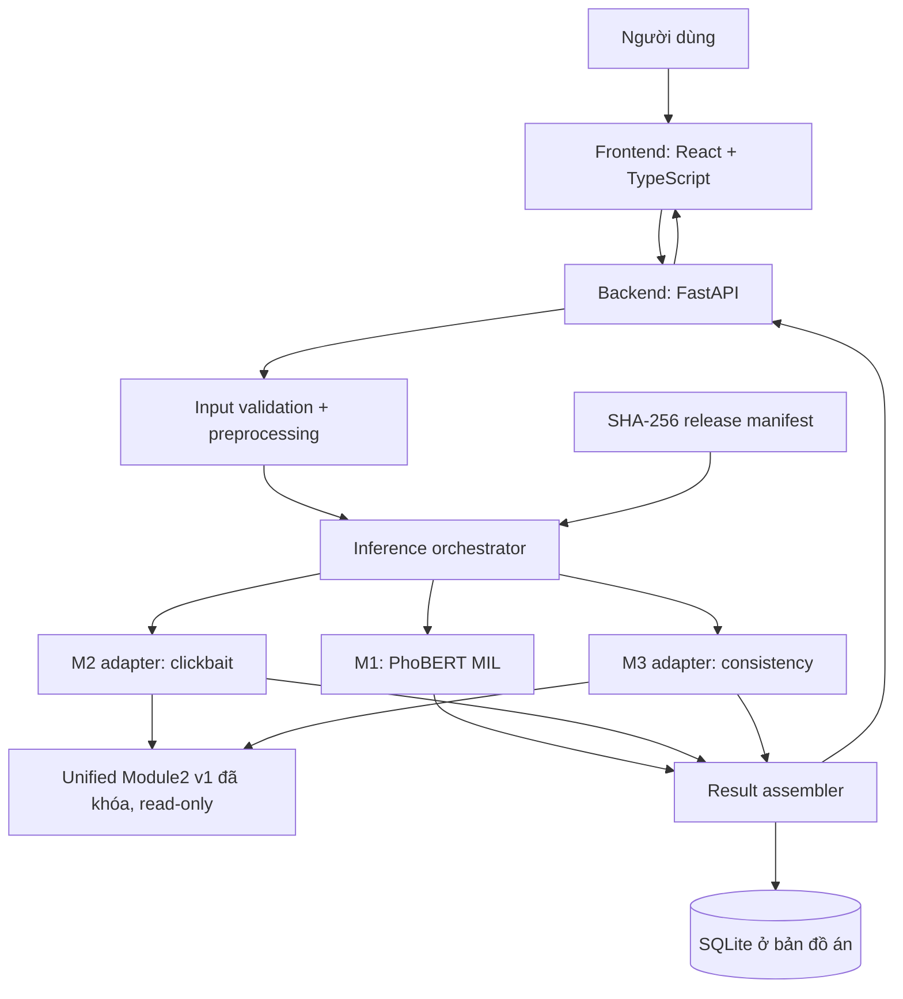
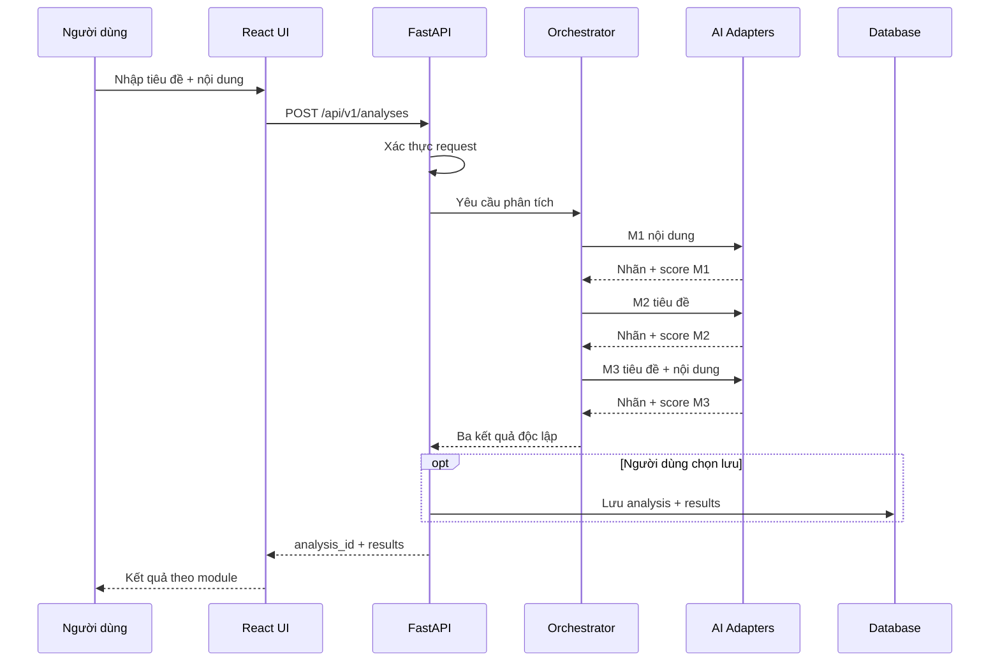
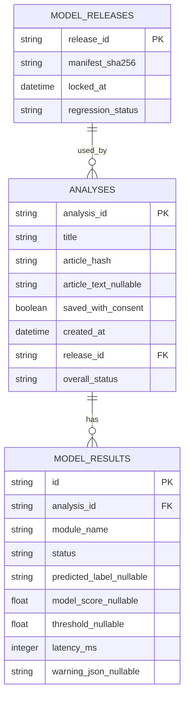

# Thiết kế hệ thống v1 — Hỗ trợ đánh giá chất lượng bài báo tiếng Việt

**Trạng thái:** BẢN THIẾT KẾ / chưa triển khai.  
**Release dự kiến:** `news_quality_models_v1`.  
**Phạm vi:** 3 nhiệm vụ độc lập, không còn module đạo văn trong bản phát hành chính.

## 1. Mục tiêu và ranh giới

Hệ thống nhận một tiêu đề và nội dung bài báo tiếng Việt, thực hiện ba phân tích:

1. **M1 — Phát hiện lỗi văn bản**: PhoBERT MIL, đầu vào nội dung bài báo. Model hiện tại phân loại khả năng có lỗi, **không định vị chính xác từ sai hoặc tự sửa**.
2. **M2 — Phát hiện clickbait**: mBERT title-only, đầu vào tiêu đề.
3. **M3 — Kiểm tra nhất quán tiêu đề–nội dung**: hybrid mBERT description + full article MAX-MIL, đầu vào cả tiêu đề và nội dung.

Không coi ba kết quả là xác minh sự thật. Không tạo "điểm chất lượng tổng" hoặc kết luận "bài báo đúng/sai" khi chưa có bộ nhãn và phép hiệu chuẩn cho điểm tổng hợp. Module đạo văn cũ lưu trữ riêng, không đưa vào API chính.

### Các baseline đã khóa về mặt nghiên cứu

| Nhiệm vụ | Mốc đánh giá test đã hoàn thành | Cấu hình cần giữ |
|---|---:|---|
| M1 lỗi văn bản | Macro-F1 0.914730; accuracy 0.914824 | `vinai/phobert-base-v2` MIL; max length 256, stride 64, max chunks 3; threshold 0.57 |
| M2 clickbait | Macro-F1 0.798830; accuracy 0.832031 | mBERT title-only; threshold 0.61 |
| M3 nhất quán | Macro-F1 0.939591; accuracy 0.939591 | Hybrid description mBERT + full-article MAX-MIL; lấy ngưỡng thực tế từ artifact/pipeline đã khóa |

Các tập test khác nhau nên **không so sánh trực tiếp** các con số này. M3 được kiểm thử chủ yếu bằng negative tổng hợp; cần nêu rõ giới hạn khi trình bày tính khái quát trên tin tức đời thực.

## 2. Sơ đồ kiến trúc



**Điểm cốt lõi khi tách Module 2 cũ:** M2 và M3 là **hai adapter logic** gọi lại unified pipeline v1, không sửa hoặc sao chép logic đã khóa. Nếu sau này phải tách thành hai service vật lý, thực hiện ở release v2 với regression kiểm tra tương đương đầu ra.

### Phân chia trách nhiệm

| Thành phần | Trách nhiệm | Không làm |
|---|---|---|
| Web UI | Nhập, hiển thị trạng thái từng module, giải thích giới hạn | Không tự tính điểm hay suy diễn nhãn |
| FastAPI | Xác thực request, điều phối, lưu metadata, trả response chuẩn | Không thay đổi threshold lúc chạy |
| M1 adapter | Tiền xử lý theo chính cấu hình M1 đã khóa, trả label + score | Không tô đậm vị trí lỗi nếu model không trả span |
| M2 adapter | Gọi clickbait branch từ unified Module2 v1 | Không huấn luyện lại |
| M3 adapter | Gọi consistency branch từ unified Module2 v1 | Không lẫn với module đạo văn |
| Model registry | Chỉ ra chính xác checkpoint, tokenizer revision, threshold, SHA256, môi trường | Không thay thế regression test |
| SQLite | Lưu lịch sử tùy lựa chọn của người dùng | Không mặc định lưu toàn văn nhạy cảm |

## 3. Luồng xử lý một yêu cầu

1. Người dùng nhập `title`, `article_text`, chọn có lưu lịch sử hay không.
2. API xác nhận hai chuỗi không rỗng, kích thước hợp lệ; tạo `analysis_id`.
3. Backend chuẩn hóa dữ liệu theo **từng adapter** (đặc biệt giữ đúng xử lý `_`/word segmentation của M1). Không dùng một hàm chuẩn hóa chung nếu làm thay đổi input đã huấn luyện.
4. Điều phối M2 trên tiêu đề; M1 trên bài báo; M3 trên tiêu đề + bài báo. Trong bản GPU 8 GB, mặc định chạy **tuần tự** và giới hạn số request inference đồng thời bằng 1.
5. Từng adapter trả nhãn, score, ngưỡng thực dùng, thời gian xử lý, cảnh báo về độ phủ (nếu bài dài vượt vùng mô hình thực sự xử lý).
6. API ghép **ba kết quả độc lập**; nếu một module lỗi thì giữ hai module thành công và thông báo riêng lỗi module còn lại.
7. Nếu người dùng chọn lưu, ghi metadata và ba dự đoán vào CSDL; toàn văn bài báo chỉ lưu khi có lựa chọn rõ ràng.



## 4. Thiết kế API dự kiến (contract, chưa phải API đang chạy)

**`POST /api/v1/analyses`**

Request:

```json
{
  "title": "Tiêu đề cần kiểm tra",
  "article_text": "Nội dung bài báo cần phân tích...",
  "save_history": false
}
```

Response đề xuất:

```json
{
  "analysis_id": "uuid",
  "release_id": "news_quality_models_v1",
  "status": "completed",
  "results": {
    "spelling": {
      "status": "completed",
      "label": "NO_ERROR",
      "model_score": 0.18,
      "decision_threshold": 0.57,
      "latency_ms": 1250,
      "warnings": []
    },
    "clickbait": {
      "status": "completed",
      "label": "NOT_CLICKBAIT",
      "model_score": 0.26,
      "decision_threshold": 0.61,
      "latency_ms": 420,
      "warnings": []
    },
    "headline_consistency": {
      "status": "completed",
      "label": "CONSISTENT",
      "model_score": 0.88,
      "decision_threshold": null,
      "latency_ms": 1500,
      "warnings": []
    }
  },
  "overall_verdict": null
}
```

**Tất cả điểm số, nhãn và độ trễ trong JSON trên chỉ là ví dụ giao diện**, không phải dự đoán thực tế hay ngưỡng đã xác minh của M3. Adapter phải đọc nhãn và xác suất đúng theo chiều nhãn trong pipeline thật; `model_score` không được gọi là xác suất đã hiệu chuẩn nếu chưa có calibration. `decision_threshold` của M3 phải được điền từ release artifact sau kiểm kê.

API khác:

| Phương thức | Đường dẫn | Công dụng |
|---|---|---|
| GET | `/api/v1/health` | Liveness, không nạp lại model |
| GET | `/api/v1/models` | Release ID, trạng thái model, phiên bản, giới hạn đầu vào; không lộ đường dẫn nhạy cảm |
| GET | `/api/v1/analyses/{analysis_id}` | Truy xuất lịch sử khi đã bật lưu |
| GET | `/api/v1/analyses` | Liệt kê lịch sử phân trang |
| DELETE | `/api/v1/analyses/{analysis_id}` | Xóa mục lịch sử |

Lỗi request trả HTTP 422; GPU bận có thể trả HTTP 429/503 tùy chế độ điều phối; lỗi module trả `status: failed` riêng để không mất kết quả của module khác. Quy định giới hạn độ dài thực tế sau khi khảo sát độ trễ, tránh một giới hạn giả định làm sai khác so với pipeline huấn luyện.

## 5. Cơ sở dữ liệu bản đồ án

Khởi đầu SQLite (thay bằng PostgreSQL khi có đa người dùng hoặc triển khai server thực tế).



`article_hash` dùng định danh/dedup kỹ thuật, **không được xem là ẩn danh hóa nội dung**. Theo mặc định `save_history=false`; không log toàn bộ tiêu đề/bài báo vào server logs.

## 6. Cấu trúc mã nguồn mới (không di chuyển checkpoint cũ)

```text
C:\\1_projectSamSung\\
├── models/                             # checkpoint M1 cũ, giữ nguyên
├── module2_headline_integrity/         # unified M2 v1, giữ nguyên
├── scripts/                            # script nghiên cứu gốc, giữ nguyên
├── module3_plagiarism_detection/        # lưu trữ nhánh nghiên cứu, không triển khai
└── system/
    ├── scripts/
    │   └── 01_model_release.py         # inventory → freeze → verify
    ├── release/
    │   ├── model_inventory_v1.json
    │   ├── model_lock_config.json
    │   ├── model_lock_manifest_v1.json
    │   └── environment_v1.json
    ├── backend/
    │   ├── app/main.py
    │   ├── app/api/routes/
    │   ├── app/core/model_registry.py
    │   ├── app/services/orchestrator.py
    │   ├── app/adapters/spelling.py
    │   ├── app/adapters/clickbait.py
    │   ├── app/adapters/headline_consistency.py
    │   ├── app/db/
    │   └── tests/
    ├── frontend/                         # React + TypeScript + Vite
    └── docs/
        └── SYSTEM_DESIGN_V1.md
```

## 7. Vận hành trên RTX 4060 Laptop 8 GB

- Khởi tạo **một tiến trình inference** cho GPU, khóa/queue `concurrency=1` từ đầu. Không chạy nhiều Uvicorn worker, vì mỗi worker có thể nạp lại toàn bộ model gây OOM.
- M1 và unified Module2 không nhất thiết phải đồng thời chiếm GPU: thực nghiệm thời gian nạp/chuyển và RAM/VRAM trước khi quyết định lazy load hay keep-alive.
- Không tự động gọi `torch.cuda.empty_cache()` mỗi request; đo đạc trước.
- Cần báo cáo p50/p95 latency trên ba độ dài văn bản mẫu, peak VRAM, cold-start và warm-run.
- Giữ preprocessing của từng model đúng snapshot, nhất là PhoBERT segmented input và MAX-MIL full-article của M3.

## 8. Quy trình khóa model trước khi viết backend

**Khóa kỹ thuật không đồng nghĩa đã regression PASS.** `01_model_release.py` thực hiện inventory + SHA256 và lưu phiên bản môi trường; không sửa checkpoint.

```bat
mkdir system\scripts
mkdir system\release
copy <noi_tai_file_duoc_tai> system\scripts\01_model_release.py
python system\scripts\01_model_release.py inventory
python system\scripts\01_model_release.py init
```

Đọc `system/release/model_inventory_v1.json`, điền chính xác hai checkpoint của M2 cũ, revision hoặc snapshot tokenizer của từng model, threshold M3 và các config quan trọng vào `system/release/model_lock_config.json`. Không đoán giá trị thiếu. Nếu tokenizer lưu theo một thư mục local, thêm cả thư mục ấy vào `additional_files` để SHA256 từng file tokenizer.

```bat
python system\scripts\01_model_release.py freeze
python system\scripts\01_model_release.py verify
```

Nếu SHA của unified pipeline khác `ac3137209f676c2e1e279a967ab642b20b05c8cc64a1c0edb741be052045ace9`, **dừng** để kiểm tra thay đổi, không tự sửa hash kỳ vọng.

Sau hash lock, chạy lại regression test đã có của Module2, smoke test M1, M2, M3 với một bộ input cố định và so sánh label/score với kết quả pipeline gốc trước khi kết luận `RELEASE ACCEPTED`. Nếu chưa có smoke test của M1, viết nó dựa trên entrypoint thực tế sau kiểm kê; không tự giả định chữ ký hàm. Không chạy/tune lại test để chọn threshold mới.

## 9. Tiêu chí hoàn tất giai đoạn thiết kế

- [ ] Manifest xác định chính xác ba model logic, checkpoint, tokenizer snapshot, threshold, cấu hình và SHA256.
- [ ] Kết quả `verify` PASS; không sửa các pipeline nghiên cứu gốc.
- [ ] Module2 regression hiện có PASS; ba adapter có cùng dự đoán với pipeline gốc trên bộ smoke cố định.
- [ ] Chốt diagram kiến trúc, API contract và schema CSDL.
- [ ] Định nghĩa cách xử lý bài dài và điều kiện hiển thị cảnh báo độ phủ M1.
- [ ] Đo cold/warm latency + peak VRAM với GPU hiện tại.
- [ ] Hoàn thiện ít nhất một kiểm thử tích hợp frontend → API → ba adapter → UI.

**Việc sẽ làm tiếp khi nhận kết quả inventory:** xác nhận đường dẫn thực của hai checkpoint M2 cũ, threshold M3, các tokenizer; đóng release manifest, sau đó dựng skeleton FastAPI và adapter wrappers trên chữ ký thật của unified pipeline. Không huấn luyện mô hình mới.
